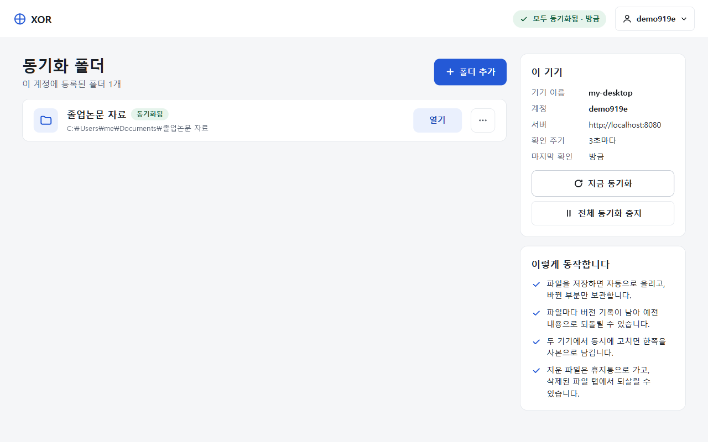
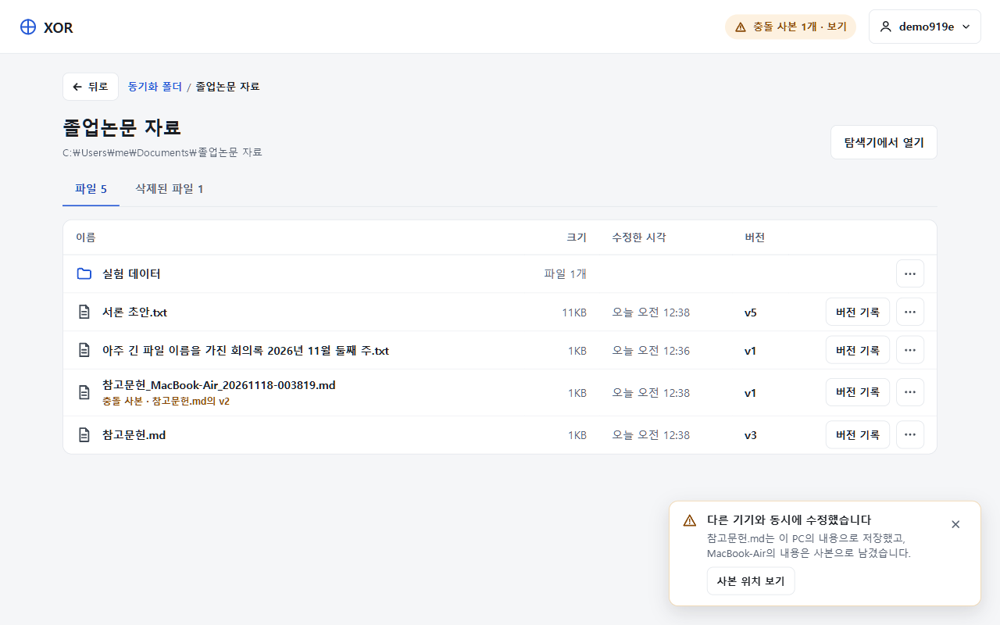
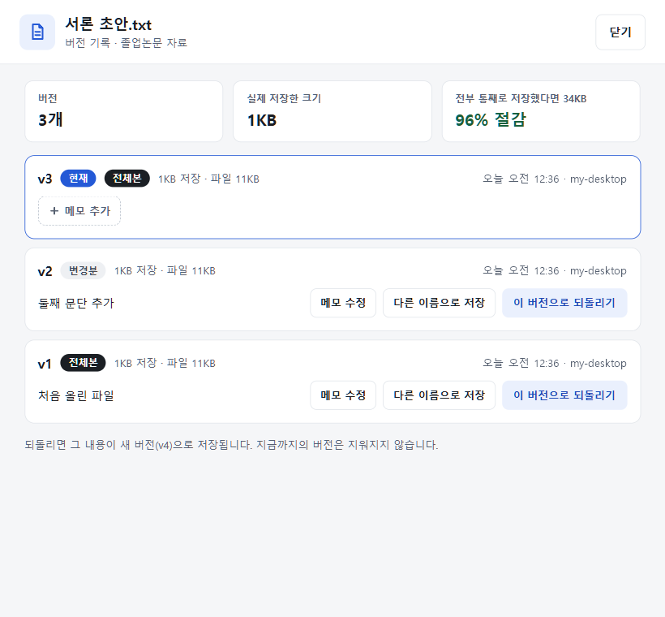
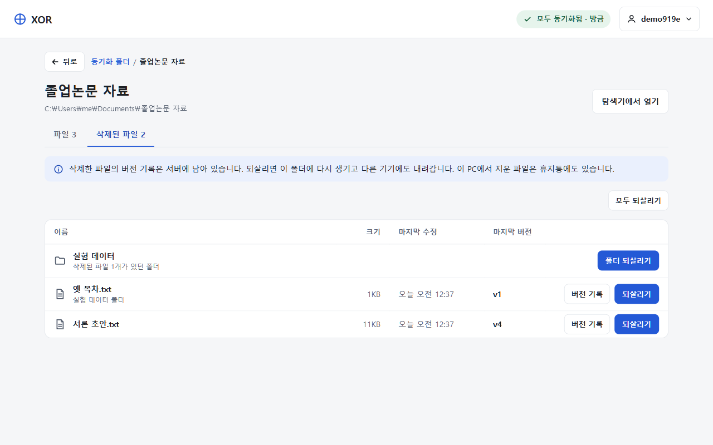
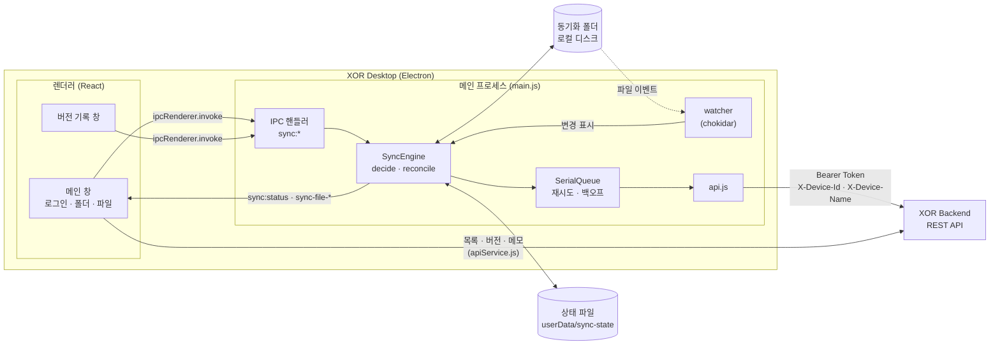
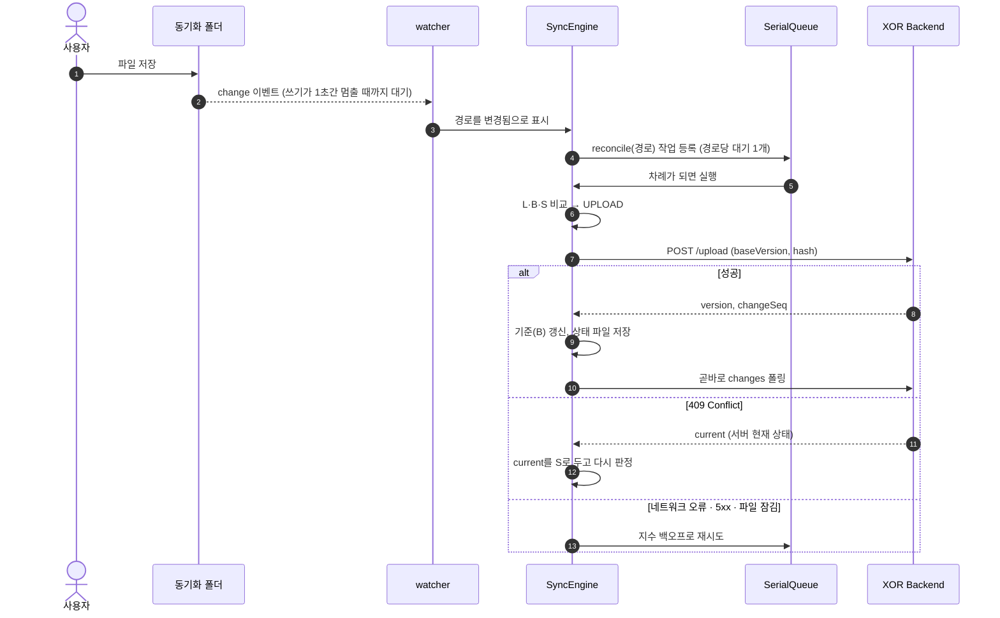
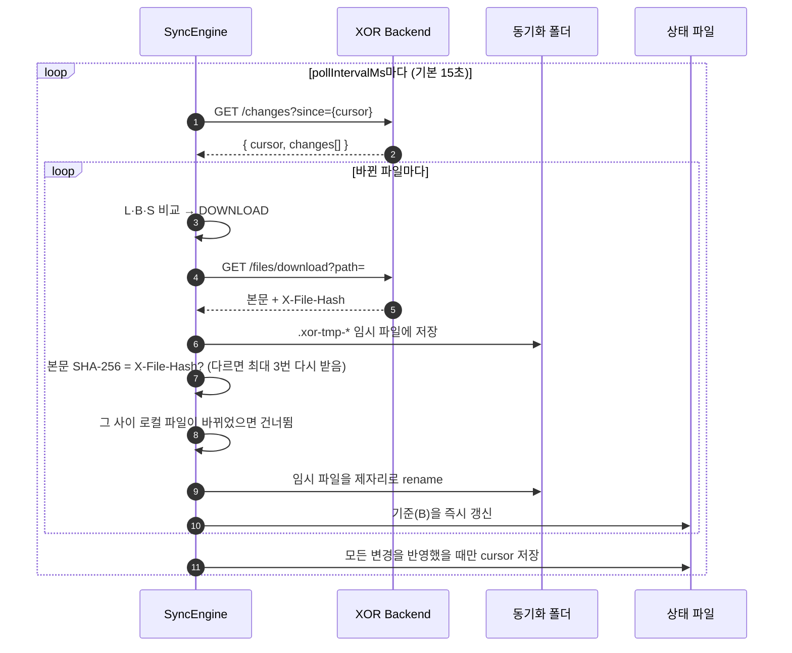
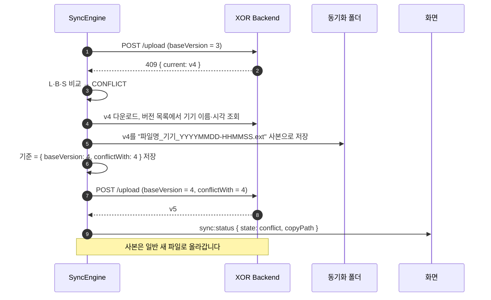

<div align="center">
  <h1>XOR Desktop</h1>
  <h3>
    내 PC의 폴더를 지정해 두면 <strong>저장할 때마다 자동으로 서버에 올리고</strong>,<br>
    다른 기기의 같은 폴더와 맞춰 주는 데스크톱 동기화 클라이언트입니다.
  </h3>
  <h4>
    XOR Desktop은 동기화 폴더를 감시하다가 파일이 바뀌면 서버에 새 버전으로 올리고,<br>
    다른 기기에서 생긴 변경은 주기적으로 받아 와 로컬에 반영합니다.<br>
    두 기기에서 동시에 고친 파일은 한쪽을 사본으로 남기고, 지운 파일은 휴지통으로 보내며,<br>
    파일마다 버전 기록을 보고 예전 내용으로 되돌리거나 되살릴 수 있습니다.
  </h4>
  <p>
    백엔드(Spring Boot): <a href="https://github.com/SMU-2025-Capstone-Design-XOR/Back-End">SMU-2025-Capstone-Design-XOR/Back-End</a>
  </p>
</div>

## 주요 기능

| 기능 | 설명 |
|---|---|
| 동기화 폴더 | 내 PC의 폴더를 그 자리 그대로 등록합니다. 다른 기기에서는 같은 폴더가 `~/XOR/{계정}/{폴더 이름}`에 연결됩니다. |
| 자동 업로드·다운로드 | 파일을 저장하면 바로 올리고, 다른 기기의 변경은 폴링(기본 15초)으로 받아 와 반영합니다. |
| 충돌 사본 | 두 기기에서 같은 파일을 동시에 고치면, 이 PC의 내용을 새 버전으로 올리고 서버 쪽 내용은 `파일명_기기이름_YYYYMMDD-HHMMSS.확장자` 사본으로 남깁니다. |
| 삭제와 되살리기 | 다른 기기에서 지운 파일은 OS 휴지통으로 보냅니다. "삭제된 파일" 탭에서 파일·폴더 단위로 되살릴 수 있습니다. |
| 버전 기록 | 파일마다 버전 목록(전체본/변경분, 저장 크기, 기기, 메모)을 보고, 원하는 버전으로 되돌리거나 다른 이름으로 저장합니다. |
| 동기화 중지 | 폴더별 또는 전체 동기화를 이 기기에서만 멈추고 다시 시작합니다. 앱을 껐다 켜도 유지됩니다. |
| 폴더 보호 | 동기화 폴더가 통째로 사라지거나 비어 있으면 "모두 삭제됨"으로 판단하지 않고 그 폴더만 멈춥니다. 위치를 다시 지정하면 이어서 동기화합니다. |
| 트레이 상주 | 창을 닫아도 트레이에 남아 계속 동기화합니다. 트레이 메뉴의 "종료"로만 끝납니다. |

## 화면

| 동기화 폴더 | 폴더 안 파일 (충돌 사본) |
|---|---|
|  |  |
| **버전 기록** | **삭제된 파일** |
|  |  |

## 기술 스택

| 영역 | 기술 |
|---|---|
| Desktop | Electron 35 |
| UI | React 18, React Router 7 |
| Build | webpack 5, Babel |
| Sync Engine | Node.js (ESM), chokidar 4 (파일 감시), `fetch` + 스트리밍 SHA-256 |
| Test | `node:test` (오프라인 단위 시험), Chrome DevTools Protocol로 실제 앱 창을 조작하는 화면 시험 |
| Packaging | electron-builder |

## 시스템 아키텍쳐



- 동기화 엔진(`sync/`)은 메인 프로세스에서 돌기 때문에 창을 숨겨도 계속 동작합니다. Electron을 import하지 않고 휴지통 함수와 이벤트 송신 함수를 주입받으므로, 스크립트와 `node --test`에서도 그대로 실행됩니다.
- 화면은 파일 목록·버전 기록·메모처럼 조회와 사용자 조작만 백엔드에 직접 요청하고, 로컬 파일을 바꾸는 일은 모두 엔진에 맡깁니다.

## 주요 데이터 흐름

### 1 판정 규칙

엔진은 파일 하나를 볼 때마다 세 상태를 비교합니다.

- **L** (로컬): 지금 디스크에 있는 파일. 크기나 수정 시각이 기준과 다를 때만 해시를 다시 계산합니다.
- **B** (기준): 마지막으로 서버와 맞췄을 때의 버전·해시. 상태 파일에 저장합니다.
- **S** (서버): `changes` 응답이나 409 응답으로 받은 서버의 현재 상태.

| L이 B와 | S가 B와 | 결과 |
|---|---|---|
| 같음 | 같음 | 할 일 없음 |
| 다름 (있음) | 같음 | 업로드 |
| 다름 (없음) | 같음 | 서버에서 삭제 |
| 같음 | 다름 (수정) | 다운로드 |
| 같음 | 다름 (삭제) | 로컬 파일을 휴지통으로 |
| 다름 (있음) | 다름 (수정) | 내용이 같으면 기준만 갱신, 다르면 **충돌 사본** |
| 다름 (없음) | 다름 (수정) | 다운로드 (수정이 삭제를 이김) |
| 다름 (있음) | 다름 (삭제) | 다시 업로드해 되살림 (수정이 삭제를 이김) |
| 다름 (없음) | 다름 (삭제) | 기준만 지움 |

### 2 로컬 변경 → 업로드



### 3 원격 변경 → 다운로드



다운로드한 파일이 다시 업로드되는 감시 루프는 "기준을 즉시 갱신"하는 것만으로 막습니다. watcher가 rename을 보고 판정을 다시 하더라도 L이 B와 같으므로 할 일이 없습니다. 타이머나 무시 목록은 쓰지 않습니다.

### 4 충돌 처리



`conflictWith`는 상태 파일에 남기 때문에, 사본을 만든 직후 앱이 꺼져도 다음 실행에서 같은 업로드를 이어 갑니다.

## IPC 요약

| 채널 | 설명 |
|---|---|
| `sync:start` / `sync:stop` | 로그인 후 엔진 시작(같은 사용자면 토큰만 바꾸고 재개) / 로그아웃 시 정지 |
| `sync:folders` | 폴더 목록과 각 폴더의 로컬 경로·멈춤 사유·중지 여부 |
| `sync:get-status` | 전체 상태(`syncing` · `idle` · `error` · `auth-required`), 대기 작업 수, 마지막 확인 시각 |
| `sync:register-folder` / `sync:remove-folder` | 동기화 폴더 등록 / 삭제 |
| `sync:pause-folder` / `sync:resume-folder` | 폴더별 동기화 중지 / 다시 시작 |
| `sync:pause-all` / `sync:resume-all` | 전체 동기화 중지 / 다시 시작 |
| `sync:relocate-folder` | 멈춘 폴더의 위치 다시 지정 |
| `sync:poll-now` | 지금 동기화 |
| `open-version-window` | 버전 기록 창 열기 |
| `open-path` / `show-item` / `save-dialog` / `open-folder-dialog` | 탐색기 열기, 파일 위치 보기, 저장·폴더 선택 대화상자 |
| `get-config` (동기) | 서버 주소 등 설정 |

엔진이 보내는 이벤트: `sync:status`, `sync-file-added` · `sync-file-updated` · `sync-file-deleted`, `dosync-folder-added` · `sync-folder-removed`

## 프로젝트 구조

```text
Front-End
├── main.js                 Electron 메인 프로세스: 창, 트레이, IPC, 엔진 연결
├── index.html              렌더러 진입 HTML (CSP)
├── webpack.config.cjs      렌더러 번들 설정 → dist/renderer.bundle.js
├── sync                    동기화 엔진 (Electron 의존 없음)
│   ├── engine.js           decide() 판정표, SyncEngine (폴링·reconcile·충돌·삭제·중지·위치 재지정)
│   ├── api.js              백엔드 REST 클라이언트, ApiError(retryable · auth)
│   ├── queue.js            SerialQueue: 한 번에 하나, 경로당 대기 1개, 지수 백오프
│   ├── watcher.js          chokidar 감시 (이벤트는 변경 표시만)
│   ├── scanner.js          폴더 순회, 스트리밍 SHA-256
│   ├── state.js            폴더별 상태 파일, 기기 ID
│   ├── paths.js            경로 정규화(NFC, '/'), 무시 규칙, 충돌 사본 이름
│   └── config.js           서버 주소·폴링 주기 설정
├── src                     렌더러 (React)
│   ├── pages               Login, Register, Home, FolderPage, VersionManager
│   ├── components          Header, Toast, Dialog, Menu, Icon
│   ├── apiService.js       화면에서 쓰는 백엔드 요청
│   ├── syncStatus.js       엔진 상태 구독 (상단 상태 표시)
│   ├── restore.js          되돌리기·되살리기·다른 이름으로 저장
│   ├── format.js           크기·시각·조사 처리
│   └── css/app.css         유일한 스타일시트 (디자인 토큰)
├── assets/tray             트레이 아이콘 (Windows .ico, macOS 템플릿 이미지)
├── test
│   ├── *.test.js           오프라인 단위 시험 (판정표, 경로, 큐, 상태 파일, 중지·위치 재지정)
│   └── e2e                 백엔드·실제 앱 창이 필요한 종단 시험
├── scripts/exp-sync.mjs    전파 지연·동시 수정 실험
└── docs/manual-tests       스크립트로 확인할 수 없는 항목의 수동 점검표
```

### 설계 특징

| 구분 | 설명 |
|---|---|
| 엔진 분리 | 동기화 로직은 메인 프로세스의 순수 Node 모듈이고, 화면은 IPC로 상태를 구독만 합니다. 엔진을 Electron 없이 시험할 수 있습니다. |
| 판정표 | 모든 동작은 L·B·S 세 상태를 비교하는 순수 함수 `decide()` 하나에서 정해집니다. 이벤트 종류(추가·수정·삭제)는 판정에 쓰지 않습니다. |
| 직렬 처리 | 작업은 한 번에 하나씩 처리하고, 같은 경로의 작업은 하나만 대기시켜 중복 업로드를 막습니다. |
| 원자적 쓰기 | 다운로드와 상태 파일은 임시 파일에 쓴 뒤 rename으로 교체해, 쓰다 만 파일이 남지 않습니다. |
| 보수적 삭제 | 파일이 없어진 것은 2초 동안 계속 없을 때만 삭제로 봅니다(Office는 저장할 때 파일을 교체함). 로컬 파일은 지우지 않고 휴지통으로 보냅니다. |
| 폴더 보호 | 기준 기록이 있는데 폴더가 없거나 비어 있으면 그 폴더만 멈추고, 서버에는 아무것도 지우지 않습니다. 폴더가 돌아와 5초간 유지되면 스스로 다시 이어 갑니다. |

## 로컬 상태 파일

서버와 마지막으로 맞춘 상태(기준 B)는 폴더마다 JSON 파일 하나로 `userData/sync-state/`에 저장합니다.

```jsonc
// {userId}-{folderId}.json
{
  "localRoot": "C:\\Users\\me\\Documents\\졸업논문 자료",
  "folderName": "졸업논문 자료",
  "cursor": 42,                       // 다음 changes?since= 값
  "paused": false,                    // 이 폴더만 동기화 중지
  "files": {
    "서론 초안.txt": {
      "fileId": 7, "baseVersion": 5, "baseHash": "…sha-256…",
      "size": 11264, "mtimeMs": 1763400000000,
      "conflictWith": 4               // 충돌 후 다시 올릴 때만
    }
  }
}
```

- `{userId}-settings.json`에는 전체 동기화 중지(`pausedAll`)를, `userData/device-id`에는 이 기기의 ID를 저장합니다.
- 상태 파일의 `folderName`이 서버의 폴더 이름과 다르면 그 상태를 버리고 처음 연결하는 것처럼 다시 맞춥니다.
- 이름이 `.`으로 시작하는 경로, `~$`로 시작하는 Office 임시 파일, `.tmp`, `Thumbs.db`, `desktop.ini`는 동기화하지 않습니다.

## 실행 방법

### 요구 사항

- Node.js (npm)
- 실행 중인 XOR Backend (기본 `http://localhost:8080`, 실행 방법은 [Back-End README](https://github.com/SMU-2025-Capstone-Design-XOR/Back-End#실행-방법) 참고)

### 실행

```bash
npm install
npm start                                   # 빌드 후 Electron 실행
XOR_API_BASE=http://<서버 주소>:8080 npm start   # 다른 서버에 연결
```

### 설정

환경 변수가 있으면 그 값을, 없으면 `userData/config.json`의 값을, 그것도 없으면 기본값을 씁니다.

| 환경 변수 | `config.json` 키 | 설명 | 기본값 |
|---|---|---|---|
| `XOR_API_BASE` | `apiBase` | 백엔드 주소 | `http://localhost:8080` |
| `XOR_POLL_MS` | `pollIntervalMs` | 폴링 주기(ms) | `15000` |
| `XOR_USER_DATA` | - | `userData` 위치 (한 PC에서 앱 두 개를 띄울 때) | Electron 기본값 |
| `XOR_HOME` | - | 다른 기기가 등록한 폴더를 둘 위치의 기준 (`{XOR_HOME}/XOR/…`) | 홈 폴더 |

### 테스트

```bash
npm test                    # 오프라인 단위 시험 (node --test)
npm run build               # 아래 종단 시험 전에 필요
npm run test:e2e:sync       # 헤드리스 엔진 두 개(기기 A·B)로 전파·충돌·삭제·오프라인 시나리오 (백엔드 필요, -- --word로 Word 저장 포함)
npm run test:e2e:tray       # 트레이 상주·창 닫기·종료·중복 실행 방지 (동기화 확인 부분은 백엔드 필요)
npm run test:e2e:screens    # 실제 앱 두 개를 CDP로 조작하는 화면 시험 + 스크린샷 (백엔드 필요)
```

트레이 아이콘 클릭이나 실제 Cmd+Q처럼 스크립트로 할 수 없는 항목은 [docs/manual-tests/tray.md](docs/manual-tests/tray.md)에 수동 점검표로 정리했습니다.

## 알려진 제한

- 빈 폴더는 동기화하지 않습니다.
- 이름 바꾸기는 "삭제 + 새 파일"로 처리합니다.
- 업로드할 때 파일 전체를 메모리로 읽습니다.
- 대소문자만 다른 이름은 서버에서 같은 파일입니다.
- macOS에서 일부 문구가 "탐색기", "이 PC"로 남아 있습니다.

## 실험

`scripts/exp-sync.mjs`는 헤드리스 엔진 두 개로 폴링 주기별 전파 지연, 동시 수정, 요청 크기를 측정합니다(백엔드 필요).

```bash
node scripts/exp-sync.mjs --out <결과 폴더>
```

## 커밋 컨벤션

`type(scope): 설명` 형식을 사용합니다.

| 커밋 타입 | 설명 | 예시 커밋 메시지 |
|:---:|---|---|
| `feat` | 새로운 기능 추가 | `feat(sync): 동기화 엔진 판정표와 폴링 추가` |
| `fix` | 버그 수정 | `fix(engine): 폴더가 사라지면 삭제 대신 멈춤` |
| `refactor` | 기능 변경 없는 구조 개선 | `refactor(ui): 화면 스타일을 app.css 하나로 정리` |
| `test` | 테스트 코드 추가 및 개선 | `test: 트레이 상주·종료 확인 스크립트 추가` |
| `docs` | 문서 수정 | `docs: README 작성` |
| `chore` | 빌드, 설정, 실험 스크립트 변경 | `chore(experiment): 전파 지연 측정 스크립트` |
